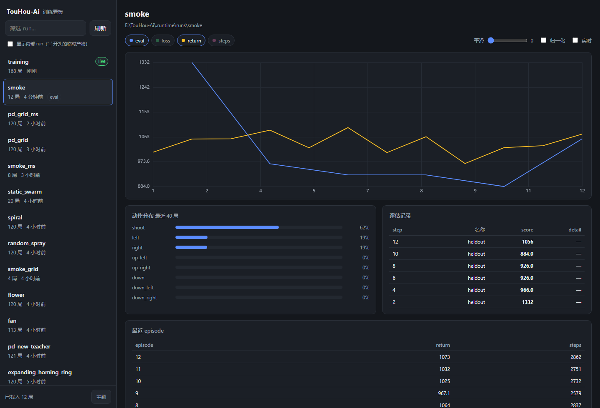

# 训练可视化看板

本地网页看板，用来观察训练过程与结果。**零新依赖**（标准库 `http.server` + 原生 canvas），
不联网、不引 CDN，断网也能用。



```powershell
# 默认扫描 .runtime，端口 8770
.\.venv\Scripts\python.exe -m touhou_rl_mcp.dashboard --open

# 指定根目录 / 端口
.\.venv\Scripts\python.exe -m touhou_rl_mcp.dashboard --root .runtime --port 8770
```

安装后也可以直接用脚本名：`touhou-rl-dashboard`。

## run 的约定

**一个 run = 一个含有 `train.jsonl` 的目录。** 这是 `training/journal.py` 已经在写的文件，
所以**已有的训练产物不需要迁移**就能被看到：`--root .runtime` 会把 `.runtime/training`、
`.runtime/mock_ppo7` 这些老目录全部识别出来。

目录里可以放：

| 文件 | 必需 | 内容 |
|---|---|---|
| `train.jsonl` | ✅ | 每行一条记录，至少要有 `episode` 和一个数值字段（如 `return`） |
| `eval.jsonl` | 可选 | 每行 `{"step": int, "name": str, "score": float}`，会按 `step` 贴回曲线上的点 |
| `meta.json` | 可选 | 任意字典，展示在标题下方（建议写配置、种子、观测规格） |
| `progress.png` 等 | 可选 | 通过 `/api/asset` 取用 |

新增一个训练脚本时，只要调用 `Journal(out_dir).episode({...})` 就是在写 run，
不需要改看板。

## 指标是自动发现的

看板不会假设任何字段名：它扫描前 60 条记录的所有数值字段（含 `reward_breakdown.graze`
这种嵌套字典），生成可勾选的曲线。**加新指标只改训练脚本，不用动前端。**

`actions` 字典例外 —— 它是动作直方图，单独渲染成条形，不进曲线。

## 界面功能

- 左侧 run 列表：按修改时间倒序，2 分钟内更新过的标 `live`
- 曲线：多指标叠加、平滑窗口、**各自归一化**（量纲差很大时用）
- 悬停：十字线 + 各指标在该点的值
- 动作分布：最近 40 局的动作占比（能一眼看出"是不是又只会按着一个键"）
- 评估记录：`eval.jsonl` 的表格
- 实时：勾选后每 2 秒增量拉取（用 `since` 只取新增记录）
- 深链接：`/?run=runs/smoke` 可直接打开某次训练

## 接口

| 路径 | 说明 |
|---|---|
| `GET /api/runs` | 所有 run（含 `age_s`、`episodes`、`has_eval`） |
| `GET /api/run?id=&since=` | 单个 run：元数据 + 增量记录 + 指标名 + 动作直方图 |
| `GET /api/asset?id=&name=` | 读取 run 目录内的产物（白名单后缀） |
| `GET /api/health` | 存活探测 |

## 扩展指引

**加一个面板**（例如"每面通关率"）：

1. 后端：在 `registry.load_run` 的返回里补一个聚合字段；
2. 前端：在 `index.html` 加容器，`app.js` 里加一个 `renderXxx()` 并在 `applyPayload` 末尾调用。
   数据刷新走同一套 `applyPayload`，实时模式自动生效。

**换一种存储**（例如把 run 放到对象存储）：只改 `registry.discover_runs` 与
`read_episodes`，`server.py` 与前端不用动。

**注意**：这是本机工具，默认只监听 `127.0.0.1`，没有鉴权。不要把 `--host` 改成
`0.0.0.0` 后暴露到公网。

## 已知限制

- 同一个 `out_dir` 被多次训练**追加**写入时，`episode` 会从 1 重新开始。因此横轴用的是
  "第几条记录"而不是 `episode` 字段；这种情况下 `eval.jsonl` 也不会按编号合并
  （可能贴错分数，宁可不贴）。
- 曲线点数没有做抽稀，单 run 上万条时会变慢；需要时在 `series()` 里加降采样。
